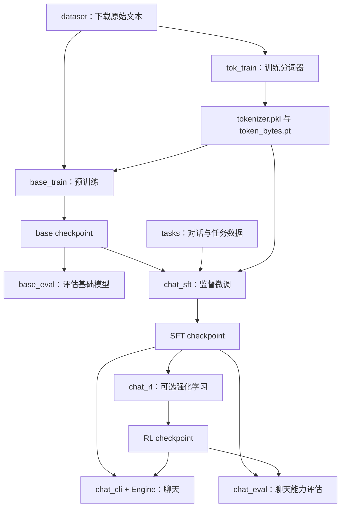

# nanochat 源码阅读指南：从文本到聊天模型

本文按代码之间的依赖和数据流组织，面向会 Python、还不熟悉 PyTorch 与 Transformer 的读者。每一节给出阅读位置、模块职责、关键代码的含义，以及它如何连接下一步。

依据：当前工作区源码，核对时 Git HEAD 为 `92d63d4`。代码中的函数名是主要定位依据；仓库注释和历史文档中的参数可能落后于实现。文中的简化代码均用于解释逻辑，不代表可以替换原实现。

## 阅读导航

| 顺序 | 这一部分解决的问题 | 主要入口 |
| --- | --- | --- |
| 1 | 整个项目如何启动、各阶段如何衔接？ | `runs/runcpu.sh`、`nanochat/common.py` |
| 2 | 原始文本从哪里来，怎样读出来？ | `nanochat/dataset.py` |
| 3 | 文字怎样变成 token ID？ | `scripts/tok_train.py`、`nanochat/tokenizer.py` |
| 4 | 文本怎样组成模型的一批输入和目标？ | `nanochat/dataloader.py` |
| 5 | 模型怎样把输入变成预测？ | `nanochat/gpt.py` |
| 6 | 预测错误怎样让参数发生变化？ | `scripts/base_train.py`、`nanochat/optim.py` |
| 7 | 模型怎样保存、恢复和评估？ | `nanochat/checkpoint_manager.py`、`scripts/base_eval.py` |
| 8 | 不同任务怎样统一成对话数据？ | `tasks/`、`render_conversation()` |
| 9 | 预训练模型怎样继续学会对话？ | `scripts/chat_sft.py` |
| 10 | 模型怎样一个 token 一个 token 地回答？ | `GPT.generate()`、`nanochat/engine.py`、`scripts/chat_cli.py` |
| 11 | 怎样评价聊天、数学和编程能力？ | `scripts/chat_eval.py`、`nanochat/execution.py` |
| 12 | 怎样用奖励继续训练模型？ | `scripts/chat_rl.py` |
| 13 | 训练和推理怎样加速、扩展到多卡？ | `nanochat/flash_attention.py`、`nanochat/fp8.py`、`nanochat/optim.py` |
| 14 | 测试、性能实验和研究脚本分别有什么用？ | `tests/`、`scripts/infer_bench.py`、`runs/`、`dev/` |

按章节顺序读即可。读一个长文件时，只跟进本节指出的函数；同一文件后面的章节再次出现，是因为它同时承担了几个不同层面的职责。

## 1. 项目的入口与整体流程

### 1.1 从运行脚本看完整过程

打开 [runs/runcpu.sh](runs/runcpu.sh)，先找到这些命令。下方省略了训练参数，只保留调用关系：

```bash
python -m nanochat.dataset -n 8
python -m scripts.tok_train --max-chars=2000000000
python -m scripts.tok_eval
python -m scripts.base_train ...
python -m scripts.base_eval ...
python -m scripts.chat_sft ...
# python -m scripts.chat_cli ...
```

`python -m scripts.tok_train` 的意思是把 `scripts/tok_train.py` 当作程序运行。最后的聊天命令在原脚本中是注释，需要另外启动。

这几条命令对应以下依赖关系：



预训练和 SFT 都会更新 GPT 参数。分词器在前面单独训练，后续阶段复用它。RL 是额外入口，当前 `runcpu.sh` 和 `speedrun.sh` 的主流程没有执行它。

### 1.2 环境、数据目录和运行设备

阅读 [nanochat/common.py](nanochat/common.py) 中的 `get_base_dir()`、`autodetect_device_type()`、`compute_init()`。

| 函数或对象 | 核心职责 | 怎样理解 |
| --- | --- | --- |
| `get_base_dir()` | 确定并创建中间产物目录 | 优先取 `NANOCHAT_BASE_DIR`，否则用 `~/.cache/nanochat` |
| `autodetect_device_type()` | 在 CUDA、MPS、CPU 中选择设备 | 决定张量和模型在哪里计算 |
| `compute_init()` | 设置随机种子、设备，必要时初始化分布式进程组 | 各训练、评估入口共享的运行准备 |
| `get_dist_info()` | 返回是否多进程、进程编号、进程总数 | 单进程时可理解为 rank=0、world_size=1 |
| `COMPUTE_DTYPE` | 决定计算使用的浮点格式 | 具体精度策略在后面的加速章节解释 |
| `print0()`、`DummyWandb` | 控制日志 | 避免多个进程重复打印，也允许不连接 wandb 记录实验 |
| `download_file_with_lock()` | 下载并缓存公共资源 | 用文件锁避免多个进程同时下载同一文件 |
| `compute_cleanup()` | 清理分布式进程组 | 与初始化配对 |

默认目录里会逐步出现这些产物：

```text
~/.cache/nanochat/
├── base_data_climbmix/       原始预训练文本分片
├── tokenizer/
│   ├── tokenizer.pkl        分词规则、词表与特殊 token 信息
│   └── token_bytes.pt       每个 token 对应的字节数
├── base_checkpoints/        预训练模型
├── chatsft_checkpoints/     对话微调后的模型
├── chatrl_checkpoints/      强化学习后的模型
├── task_data/               tasks 使用的数据缓存
└── eval_bundle/             基础模型 CORE 评估资源
```

[pyproject.toml](pyproject.toml) 描述项目依赖和 CPU/GPU 安装选项，[uv.lock](uv.lock) 记录依赖解析结果。它们负责环境复现。`nanochat/__init__.py` 当前为空，没有需要追踪的业务逻辑。

## 2. 原始文本：nanochat/dataset.py

文件：[nanochat/dataset.py](nanochat/dataset.py)。

**核心职责：下载预训练数据，并把 Parquet 文件里的文本读成 Python 字符串列表。** 它不负责把文本变成模型输入张量。

阅读顺序：文件底部 `__main__` → `download_single_file()` → `list_parquet_files()` → `parquets_iter_batched()`。

### 2.1 下载哪些文件

```bash
python -m nanochat.dataset -n 8
```

`argparse` 把 `-n 8` 解析为 `args.num_files = 8`。后面的关键代码是：

```python
num_train_shards = MAX_SHARD if args.num_files == -1 else min(args.num_files, MAX_SHARD)
ids_to_download = list(range(num_train_shards))
ids_to_download.append(MAX_SHARD)
```

当前 `MAX_SHARD = 6542`。传入 `8` 后，下载编号 `0` 到 `7` 的训练分片，再额外下载编号 `6542` 的验证分片，共 9 个文件。`-n -1` 的实际行为是选择全部训练分片。

编号通过 `index_to_filename()` 变成 `shard_00000.parquet` 这样的文件名。`download_single_file()` 负责拼接 URL、跳过已存在的文件、流式下载到 `.tmp` 文件、完成后改名，并在失败时重试。`Pool.map()` 让多个进程分别处理文件。

### 2.2 怎样读取文本

`list_parquet_files()` 返回按名字排序的文件路径。`parquets_iter_batched()` 中最关键的代码是：

```python
parquet_paths = parquet_paths[:-1] if split == "train" else parquet_paths[-1:]
for filepath in parquet_paths:
    pf = pq.ParquetFile(filepath)
    for rg_idx in range(start, pf.num_row_groups, step):
        rg = pf.read_row_group(rg_idx)
        texts = rg.column('text').to_pylist()
        yield texts
```

Parquet 可以理解成磁盘上的表格，row group 是其中便于成批读取的一组行。这里取出 `text` 列，得到类似这样的对象：

```python
["第一篇文章的内容……", "第二篇文章的内容……"]
```

`yield` 使函数成为生成器，调用方每次 `next()` 才获得下一批文本。这个函数按 row group 读取，没有把整个预训练语料一次性放进内存。

训练/验证的划分依赖“排序后的最后一个文件”：下载入口特意把最后编号的验证文件也下载下来，正好与这里的规则配套。

**与下一步的连接：** `scripts/tok_train.py` 调用这个生成器，用返回的文本训练分词器。预训练的数据加载器还会使用本模块列出文件，但有自己处理循环、分布式分片和恢复位置的逻辑。

## 3. 分词：文字如何变成数字

### 3.1 scripts/tok_train.py：把分词器训练过程串起来

文件：[scripts/tok_train.py](scripts/tok_train.py)。阅读顺序：参数 → `text_iterator()` → `RustBPETokenizer.train_from_iterator()` → 保存与字节统计。

**输入：原始文本。输出：可复用的分词器与 token 字节数表。**

`text_iterator()` 把一批批文本展开为一篇篇文本：

```python
for batch in parquets_iter_batched(split="train"):
    for doc in batch:
        # 原实现还会按 doc_cap 裁剪，并累计字符数
        yield doc_text
```

`--doc-cap` 限制单篇文档长度，`--max-chars` 限制用于训练的总字符量。因为停止判断在文档边界进行，总量可能略超过上限。这里统计的是字符数，不是模型训练时的 token 数。

随后调用：

```python
tokenizer = RustBPETokenizer.train_from_iterator(text_iter, args.vocab_size)
```

这一步学习文本的切分规则。它还没有创建 GPT，也没有训练神经网络参数。

### 3.2 nanochat/tokenizer.py：分词器真正的实现

文件：[nanochat/tokenizer.py](nanochat/tokenizer.py)。先读 `SPECIAL_TOKENS`、`train_from_iterator()`、`encode()`、`decode()`；对话相关方法留到第 9 节。

**token 是文本片段，token ID 是该片段在词表中的整数编号。** 一个 token 可能对应词的一部分、标点、空格或若干字节。编号只是索引，编号大小没有语义上的大小关系。

BPE 的基本想法是：从小单位开始，在训练文本中反复寻找常见的相邻组合，为合并后的片段建立词表项。这里只需把握“从语料统计中学出切分方式”。本项目把核心训练交给 `rustbpe`，没有在 Python 中手写完整的合并算法。

`train_from_iterator()` 做了几件具体的事：

1. 从目标词表大小中扣除特殊 token 的数量。
2. 用 `SPLIT_PATTERN` 先划分文本，再调用 `rustbpe.Tokenizer().train_from_iterator()` 学习合并规则。
3. 取出得到的规则和字节片段，用它们构造 `tiktoken.Encoding`。
4. 加入特殊 token，返回项目自己的 `RustBPETokenizer` 包装对象。

因此，**rustbpe 负责训练规则，tiktoken 负责后续高效编码与解码。** 字节级处理使词表可以表达训练时未出现过的文本；单个 token 的字节不一定能独立解码成完整的 Unicode 字符。

| 方法 | 输入 → 输出 | 核心作用 |
| --- | --- | --- |
| `encode(text)` | 字符串 → `list[int]` | 普通文本编码；传入字符串列表时返回编号列表的列表 |
| `decode(ids)` | `list[int]` → 字符串 | 根据编号还原文本 |
| `encode_special(name)` | 特殊标记名称 → 一个整数 | 明确插入文档、角色或工具边界 |
| `get_bos_token_id()` | 无 → 一个整数 | 获取文档起始标记 |
| `save()` / `from_directory()` | 分词器对象 ↔ 磁盘文件 | 保存、加载训练得到的规则 |
| `get_tokenizer()` | 缓存目录 → 分词器对象 | 供训练、评估和聊天入口复用 |
| `get_token_bytes()` | 缓存文件 → 字节数张量 | 为 BPB 评估提供每个 token 的字节数 |

`encode()` 使用普通文本编码接口。文本里碰巧出现字符串 `<|bos|>`，不等于自动插入真正的 BOS 特殊 token；插入特殊 token 需要 `encode_special()` 或 `prepend` 等明确的接口。

### 3.3 为什么额外保存 token_bytes.pt

训练完成后，`tok_train.py` 遍历词表，统计每个 token 原始字节串的长度；特殊 token 的字节数设为 0。

后面评估模型时，希望知道“预测每个文本字节需要多少信息”，而不是只看每个 token 的损失。不同分词器切出的 token 长短不同，按字节归一化能减少这种比较中的差异。第 7 节会看到具体公式。

### 3.4 scripts/tok_eval.py：检查切分结果

文件：[scripts/tok_eval.py](scripts/tok_eval.py)。核心是后半部分遍历分词器和测试文本的循环；前面的大段文本只是测试样例。

它对项目分词器、`gpt2` 和 `cl100k_base` 的切分结果进行比较，检查编码再解码是否还原原文，并统计：

```text
压缩比 = 文本 UTF-8 字节数 / token 数
```

同一段文本下，这个比值越大，表示用越少的 token 表达了它。这是切分效率指标，不能单独据此断定最终模型更聪明。

**与下一步的连接：** 此时已有“文本 → token ID 列表”的工具，数据加载器可以开始把列表组合成张量。

## 4. 训练数据：nanochat/dataloader.py

文件：[nanochat/dataloader.py](nanochat/dataloader.py)。

**核心职责：持续读取文本、编码、拼接，产出形状固定的 `inputs`、`targets`，以及恢复读取所需的位置。**

阅读顺序：`_document_batches()` → `refill_buffer()` → 填满每一行的循环 → 输入目标错位 → `yield`。

### 4.1 第一次遇到张量与形状

在这里，把张量理解成带有数值类型、设备信息的多维数组即可：

| 记号 | 含义 | 例子 |
| --- | --- | --- |
| `B` | 一批里有多少条序列 | `B=2` 就是两行 |
| `T` | 每条输入序列有多少个 token | `T=4` 就是每行四个位置 |
| `[B, T]` | 二维张量的形状 | `[2, 4]` |
| `dtype` | 元素类型 | token ID 使用整数；模型内部特征使用浮点数 |
| `device` | 张量所在设备 | CPU、CUDA GPU 或 MPS |

后面遇到 `tensor.size()` 或 `tensor.shape`，读到的是维度大小。`view()`/`reshape()` 改变数据的维度组织；`transpose()` 交换维度。它们本身不代表模型学到了新知识。

### 4.2 文本如何进入缓冲区

`_document_batches()` 按文件和 row group 读取文本。多进程时，不同 rank 读取不同的 row group；读完后可以重新循环，并增加 epoch 计数。

`refill_buffer()` 调用：

```python
token_lists = tokenizer.encode(doc_batch, prepend=bos_token, num_threads=tokenizer_threads)
```

每篇文档都在开头加入 BOS，再把编号列表放进 `doc_buffer`。此时数据从 `list[str]` 变成了 `list[list[int]]`。

### 4.3 为什么先准备 T + 1 个 token

原实现中：

```python
row_capacity = T + 1
# 中间的循环填满 row_buffer
cpu_inputs.copy_(row_buffer[:, :-1])
cpu_targets.copy_(row_buffer[:, 1:])
```

假设一行的编号是下面这些数字，它们只是说明用的编号：

```text
原始一行： 10 20 30 40 50
inputs：  10 20 30 40
targets： 20 30 40 50
```

对应四个预测任务：看到 `10` 预测 `20`；看到 `10,20` 预测 `30`；依此类推。每个位置根据自身及允许看到的过去位置预测下一个 token。最后一个目标 `50` 需要来自输入末尾之外，所以先准备 `T+1` 个 token。

`[:, :-1]` 表示保留所有行、去掉每行最后一个元素；`[:, 1:]` 去掉每行第一个元素。`copy_()` 把结果写入已分配的张量，下划线表示原地修改目标。

### 4.4 文档长度不一样，怎样填满一行

这里用 BOS 对齐和 best-fit 拼接：

1. 每一行从一篇文档的 BOS 开始。
2. 在缓冲区里寻找能放进剩余空间的最长完整文档。
3. 放入后继续寻找，直到剩余空间容不下任何完整文档。
4. 这时选最短文档，取其前缀填满剩余空间，丢弃这一文档未使用的部分。

因此一行可以包含多篇文档。预训练 loader 通过裁剪避免 padding，但会丢弃一些 token。源码注释给出的裁剪比例是特定配置下的经验值，不是所有数据都固定如此。

BOS 是文档边界标记，**加入 BOS 本身不会阻止注意力跨文档访问**；当前这里没有构造按文档隔离的注意力遮罩。注意力实际允许看哪些位置，要到模型里看。

### 4.5 返回给训练脚本的内容

```python
yield inputs, targets, state_dict
```

`inputs` 和 `targets` 都是 `[B,T]`。`state_dict` 记录 `pq_idx`、`rg_idx`、`epoch`。无状态版本 `tokenizing_distributed_data_loader_bos_bestfit()` 只是省略了第三项，适合评估使用。

这里的恢复是近似恢复：记录的是文件与 row group 等位置，没有完整序列化缓冲区中尚未消费的文档。因此不能理解成恢复后逐 token 重放完全一致。

**与下一步的连接：** 训练脚本拿到 `x, y` 后调用 `model(x, y)`。接下来读模型怎样使用它们。

## 5. 模型：nanochat/gpt.py

文件：[nanochat/gpt.py](nanochat/gpt.py)。它定义模型结构和前向计算；外部脚本负责循环喂数据和调用优化器。

建议按本节顺序定位：`GPTConfig` → `GPT.__init__()` → `GPT.forward()` 的主线 → `Block` → `MLP` → `CausalSelfAttention` → 位置编码 → 初始化与项目额外设计。

### 5.1 先认识 PyTorch 模型对象

`GPT`、`Block`、`MLP` 都继承 `nn.Module`。可以把它理解成“能够管理子模块、可训练参数和前向计算的 Python 对象”。

在 PyTorch 中，`model(x, y)` 会通过模块的调用机制进入 `forward(x, y)`。`nn.Parameter` 表示需要训练的参数，`ModuleList`、`ModuleDict` 让框架识别并管理内部层。参数不是训练过程中临时计算出来的特征，它们是反复被更新并最终保存到 checkpoint 的数值。

### 5.2 配置决定模型的大小

`GPTConfig` 的核心字段：

| 字段 | 作用 |
| --- | --- |
| `vocab_size` | 模型需要识别和预测多少种 token |
| `sequence_len` | 配置中的上下文长度，也参与注意力窗口设置 |
| `n_layer` | Transformer Block 的层数 |
| `n_embd` | 每个 token 的特征向量长度，后文记为 `C` |
| `n_head` | Query 注意力头数 |
| `n_kv_head` | Key/Value 注意力头数 |
| `window_pattern` | 各层采用长窗口还是短窗口的模式 |

每个注意力头的维度 `D = C / n_head`，所以 `C` 必须能被头数整除。

训练入口的 `build_model_meta(depth)` 根据深度和 `aspect_ratio` 算宽度，再向上调整到 `head_dim` 的整数倍。当前训练入口把 `n_kv_head` 设成与 `n_head` 相同；模型支持 GQA，不代表默认训练已经使用更少的 KV 头。

### 5.3 一次前向计算的整体形状

```text
token ID                    [B, T]
  ↓ 输入 Embedding
每个 token 的特征向量        [B, T, C]
  ↓ 多层 Transformer Block
结合上下文后的特征向量       [B, T, C]
  ↓ lm_head 输出投影
每个位置对词表的预测分数     [B, T, V]
  ↓ 与 targets 比较（训练时）
loss                        默认是一个标量
```

`V` 是实际词表大小。模型内部为计算效率把词表维度补齐到 64 的倍数，输出时再裁回真实词表大小。

### 5.4 Embedding：从编号查出向量

`GPT.__init__()` 中创建：

```python
"wte": nn.Embedding(padded_vocab_size, config.n_embd)
```

可以把它理解成一张可训练的表：每行对应一个 token ID，每行存一个长度为 `C` 的浮点向量。前向里的：

```python
x = self.transformer.wte(idx)
```

就是按 `idx` 查表，把 `[B,T]` 变成 `[B,T,C]`。这个表会通过训练改变；分词器的词表编号并不会因此改变。

### 5.5 Block：一层内做两次信息处理

`Block.forward()` 的主体只有两行：

```python
x = x + self.attn(norm(x), ve, cos_sin, window_size, kv_cache)
x = x + self.mlp(norm(x))
```

第一行让当前位置从允许看到的其他位置收集信息。第二行对每个位置的特征做非线性变换。两次输出都加回原来的 `x`，这就是残差连接：保留已有表示，同时加入本层算出的调整。

`norm()` 使用 RMSNorm，沿最后一个特征维度调整数值尺度，帮助多层计算保持稳定。这里没有可学习的 RMSNorm 缩放参数。先归一化再进入子模块，因此属于 pre-norm 的组织方式。

### 5.6 MLP：在一个位置内部加工特征

```python
x = self.c_fc(x)
x = F.relu(x).square()
x = self.c_proj(x)
```

形状变化是 `[B,T,C] → [B,T,4C] → [B,T,4C] → [B,T,C]`。先扩大特征空间，进行非线性变换，再投影回来。这里的激活是 ReLU 的平方。

MLP 的这些操作不混合不同序列位置；同一组权重分别作用于每个位置。跨位置的信息交换主要发生在注意力中。

### 5.7 Attention：根据当前位置决定从哪里取信息

`CausalSelfAttention.forward()` 先对输入做三个不同的线性投影：

```python
q = self.c_q(x).view(B, T, self.n_head, self.head_dim)
k = self.c_k(x).view(B, T, self.n_kv_head, self.head_dim)
v = self.c_v(x).view(B, T, self.n_kv_head, self.head_dim)
```

可以这样理解三者：Query 是当前位置用来匹配上下文的表示；Key 是各位置供匹配的表示；Value 是匹配成功后要汇总的信息。它们都从当前输入算出，并非额外读取的外部资料。

先用一个头理解基本计算：

```text
匹配分数 = Q × Kᵀ / sqrt(D)
注意力权重 = softmax(加上位置限制后的匹配分数)
输出 = 注意力权重 × V
```

这是帮助理解的标准表达式。实际代码在调用注意力函数前，还会对 Q/K 应用 RoPE、RMSNorm，并分别乘以 `1.2`；有些层还会给 V 加入 Value Embedding。

多头意味着把这一过程并行做成多个组，允许不同头用不同投影处理信息。最后把各头结果拼回 `[B,T,C]`，经 `c_proj` 投影回残差流。

**因果限制：** 第 `t` 个位置只能看当前位置与允许范围内的过去位置，不能看 `t+1`。虽然整个训练输入一次送入模型，这个限制防止模型直接读取下一位置的答案。于是各位置的训练预测可以在一次前向中并行计算。

如果 `n_kv_head < n_head`，多组 Query 头共享较少的 Key/Value 头，这就是 GQA，能减少 KV 相关的存储需求。

### 5.8 RoPE 与滑动窗口

`_precompute_rotary_embeddings()` 预计算位置对应的正弦、余弦；`apply_rotary_emb()` 对 Q、K 的向量分量做位置相关的旋转。这样，匹配分数能够受到两个位置相对关系的影响。

这里没有像传统绝对位置 Embedding 那样，把一张位置表直接加到 token 向量上。源码采用的旋转符号约定与部分教材不同，学习时跟随其实际公式即可。

`_compute_window_sizes()` 把 `window_pattern` 展开到所有层，最后一层固定使用长窗口。`L` 对应配置的完整窗口，`S` 对应较短窗口。窗口限制和因果限制同时生效。短窗口的精确大小以计算表达式为准，例如当前表达式在 `sequence_len=2048` 时给出左窗口 `512`，而非某些注释里的其他数值。

### 5.9 输出分数与训练损失

`lm_head` 把每个位置的 `C` 维表示投影到词表，产生 logits。**logits 是未归一化分数，不是概率。** 输入 Embedding 和输出投影在这里是两套独立参数。

模型先截掉词表补齐部分，把 logits 转成 float32，并用 `15 * tanh(logits / 15)` 平滑限制其幅度，然后进入两种路径：

```python
if targets is not None:
    loss = F.cross_entropy(
        logits.view(-1, logits.size(-1)),
        targets.view(-1),
        ignore_index=-1,
        reduction=loss_reduction,
    )
    return loss
else:
    return logits
```

把 `[B,T,V]` 展平成 `[B*T,V]`，就是把所有位置当作独立的分类预测来计分。目标 `[B,T]` 相应展平成 `[B*T]`。

交叉熵在这里等于正确目标 token 的负对数概率。模型给正确目标越高的概率，该位置损失就越小。它内部处理归一化，不需要先手动对 logits 做 softmax。

默认返回平均损失；`loss_reduction='none'` 返回展开后的逐位置损失，调用方再按需要 reshape。目标为 `-1` 的位置不计分，SFT 和 RL 会用到这个机制。

**目标错位发生在数据加载器中，`GPT.forward()` 不会再次把 targets 移动一位。**

### 5.10 当前项目额外加入的结构

读懂基础主线后，再回到 `GPT.forward()` 和初始化代码看这些部分：

| 名称 | 代码实际做什么 | 如何理解其位置 |
| --- | --- | --- |
| `smear_gate`、`smear_lambda` | 把前一个位置的归一化输入 Embedding 按门控混入当前位置 | 在进入多层 Block 前，直接提供相邻 token 的信息；缓存推理时要额外保留上一个 Embedding |
| `resid_lambdas` | 每层前对当前残差流做可学习缩放 | 调节上一层表示进入本层的强度 |
| `x0_lambdas` | 每层前混入保存的初始表示 `x0` | 给深层增加回看输入表示的路径 |
| `value_embeds`、`ve_gate` | 在交替的指定层，用 token ID 查出另一套向量，经门控加到 V | 在上下文变换之外，把 token 本身的信息补入 Value |
| `backout_lambda` | 输出前减去按比例缩放的中途层表示 | 修改进入最终归一化和输出投影的表示 |
| Q/K 归一化与缩放 | 对 Q、K 归一化并调整幅度 | 改变注意力匹配分数的尺度 |

这些是当前实现的具体设计；仅从代码能确认计算方式，效果需要看实验，不能把作者注释中的动机当作普遍保证。

### 5.11 为什么构造模型之后还有 init_weights()

训练脚本的创建顺序是：

```python
with torch.device("meta"):
    model = GPT(config)
model.to_empty(device=device)
model.init_weights()
```

`meta` 阶段只建立形状和模块结构，不分配实际参数存储；`to_empty()` 在目标设备上分配存储；`init_weights()` 才填入真正的初始值，并生成 RoPE 缓冲区。

这里有零初始化的输出投影、专门设置的残差系数等策略。以 `init_weights()` 的赋值为准，例如当前输入 Embedding 的初始化标准差是 `0.8`。构造函数旁边的“默认值”注释不一定就是实际初始化值。

**与下一步的连接：** 模型现在可以接受 `x,y` 并返回 loss，但参数还需要由训练循环更新。

## 6. 预训练与参数更新

### 6.1 scripts/base_train.py：训练的总调度入口

文件：[scripts/base_train.py](scripts/base_train.py)。

**核心职责：把运行环境、分词器、模型、数据加载器、优化器、评估和保存串成训练过程。** 模型内部的数学计算在 `gpt.py`，训练执行多少次、什么时候评估由这里决定。

阅读这个长脚本时，先找到 `# single training step`，理解最小循环，再往前追踪初始化。完整执行顺序如下：

| 顺序 | 代码位置 | 做什么、为什么需要 |
| --- | --- | --- |
| 1 | `argparse` 参数区 | 接收模型深度、序列长度、batch、训练步数等配置 |
| 2 | `compute_init()` 与日志初始化 | 准备设备、进程和实验记录 |
| 3 | `get_tokenizer()`、`get_token_bytes()` | 取得词表大小和后续评估所需信息 |
| 4 | `build_model_meta()`、`init_weights()` | 创建并初始化 GPT |
| 5 | 恢复 checkpoint 的分支 | 指定恢复时，用已有参数和训练状态覆盖初始化值 |
| 6 | FP8 分支、`torch.compile()` | 可选改变计算执行方式；先把它们当作性能层处理 |
| 7 | `get_scaling_params()` 及相关计算 | 根据模型规模推算训练 token 量、总 batch、学习率与权重衰减 |
| 8 | `setup_optimizer()` | 为不同参数安排更新规则，并按需恢复优化器状态 |
| 9 | 创建 train/val loader | 取得第一批 `x,y`，准备验证数据生成器 |
| 10 | 训练时长与调度器 | 决定一共多少步，以及各步的学习率等参数 |
| 11 | `while True` | 评估、采样、保存，执行一次训练，再重复 |

`orig_model` 和编译后的 `model` 使用同一套底层模型参数。保留原对象是为了保存状态，以及处理评估和生成中变化的输入形状。

### 6.2 先理解一次参数更新

把原脚本中的梯度累积、混合精度、日志等细节暂时折叠，核心逻辑可以写成以下解释性伪代码：

```python
x, y = next(train_loader)
loss = model(x, y)
loss.backward()
optimizer.step()
model.zero_grad(set_to_none=True)
```

每一步的含义：

1. `next(train_loader)` 得到输入和正确目标。
2. `model(x,y)` 做前向计算，得到预测与目标的差距。
3. `loss.backward()` 沿前向计算建立的依赖关系计算梯度，写入各参数的 `.grad`。梯度表示损失对参数变化的局部敏感程度。
4. `optimizer.step()` 使用梯度及历史状态更新参数。真正改动权重发生在这里。
5. `zero_grad()` 清掉本次梯度，供下一轮重新累计。

前向和反向传播本身并不等于更新参数。`detach()` 常用于拿一份不参与求导的值记日志；`item()` 将单元素张量转成 Python 数值，在 GPU 上还可能引入等待。

### 6.3 梯度累积与 batch 的单位

当前脚本的 `--device-batch-size` 是每个设备一次处理的序列条数，`--total-batch-size` 是一次参数更新覆盖的总 token 数。它们单位不同。

```text
每次前向/反向的全局 token 数 = B × T × world_size
梯度累积次数 A = total_batch_size / (B × T × world_size)
```

例如 `B=2`、`T=4`、单设备、总 batch 为 32 token，需要累计 4 次前向/反向，再更新一次参数。

原脚本会把每个 micro-step 的 loss 除以 `A` 再反向传播，因为 PyTorch 默认把多次反向产生的梯度相加。这样得到的是对应平均目标的梯度，而不是无意把梯度扩大 `A` 倍。

### 6.4 训练多久、学习率怎么变

决定 `num_iterations` 的优先级是：显式训练步数 → 目标 FLOPs → 参数与数据比例推导出的 token 预算。

当前 `get_scaling_params()` 使用 Transformer 矩阵参数和输出 `lm_head` 参数之和作为特定统计口径，并不等于模型全部参数。估算参数、token 数、FLOPs 时，需要先看清口径。

`get_lr_multiplier()` 实现开始逐渐升高学习率、保持一段时间、末尾再降低的过程。`get_muon_momentum()` 和 `get_weight_decay()` 另外调整 Muon 的动量与权重衰减。理解时把它们看作“训练到不同阶段时，更新步子的大小和方式也会变化”。

这些自动缩放规则是本项目采用的经验配置。代码中也说明了部分从 AdamW 借来的关系被用于 Muon，不能把它们视为对任意优化器都成立的定律。

### 6.5 nanochat/optim.py：怎样把梯度变成参数变化

文件：[nanochat/optim.py](nanochat/optim.py)。先读 [gpt.py](nanochat/gpt.py) 的 `setup_optimizer()` 决定的分组，再读 `MuonAdamW.step()` 和两个更新函数。

**输入：参数、梯度、优化器历史状态。输出：原地更新的参数和新的历史状态。**

`setup_optimizer()` 为每组参数指定 `kind`。Transformer Block 内的矩阵使用 Muon；输入/Value Embedding、输出投影、残差系数及 smear/backout 相关参数使用 AdamW。不是看到二维张量就自动选 Muon，最终以分组代码为准。

`adamw_step_fused()` 的顺序是：权重衰减 → 梯度的一阶和二阶移动平均 → 初始偏差校正 → 参数更新。直观上，它既参考当前方向，也参考历史方向和幅度，使不同参数的更新尺度可以不同。

`muon_step_fused()` 处理一组同形状矩阵：先形成动量更新方向，再做行尺度调整和近似正交化，接着进行范数与方差相关的缩放，最后结合有条件的权重衰减更新参数。它操作的是**更新方向**，不是把模型的权重永久强制变成正交矩阵。

理解 Muon 的数学细节前，可以先跟住“梯度 → 加工后的更新方向 → 参数变化”。其迭代系数是算法细节；同形状参数堆叠则主要是为了高效批量处理。分布式通信在第 13 节展开。

**与下一步的连接：** 训练产生可用的模型参数，也产生动量等历史状态；保存与恢复需要把这两类东西区分开。

## 7. 保存模型与评估预训练效果

### 7.1 nanochat/checkpoint_manager.py：保存什么

文件：[nanochat/checkpoint_manager.py](nanochat/checkpoint_manager.py)。阅读顺序：`save_checkpoint()` → `load_checkpoint()` → `build_model()` → `load_model()`。

| 文件 | 内容 | 为什么需要 |
| --- | --- | --- |
| `model_000100.pt` | 模型参数的 `state_dict` | 保存模型学到的数值 |
| `optim_000100_rank0.pt` | 对应 rank 的优化器状态 | 继续训练时恢复动量等历史信息 |
| `meta_000100.json` | 模型配置、步数及调用方提供的元数据 | 知道怎样重建模型、训练进行到了哪里 |

文件名中的步数只是示例。模型和元数据由 rank 0 保存；优化器状态可能分片，各 rank 保存自己的文件。预训练的元数据还包含数据读取位置和训练循环状态。

`build_model()` 读配置、创建 GPT、初始化必要缓冲区、加载参数，再加载分词器。它还处理部分旧 checkpoint 的字段缺失和编译器给参数名加前缀等兼容问题。

`load_model(source, ...)` 把 `base`、`sft`、`rl` 映射到对应目录。未指定模型标签时，优先按 `d数字` 标签选择深度最大的模型；未指定步数时，选择编号最大的 checkpoint。这不是根据验证分数选择“效果最好的模型”。

分词器是单独从公共缓存目录加载的。代码检查词表大小匹配，但词表大小相同不代表 token ID 的含义相同；阅读时要意识到模型权重必须搭配训练它时使用的分词器。

### 7.2 nanochat/loss_eval.py：按字节评价文本预测

文件：[nanochat/loss_eval.py](nanochat/loss_eval.py)，核心函数 `evaluate_bpb()`。

它从 loader 取出 `x,y`，请求模型返回每个位置的损失。然后用 `token_bytes` 把目标 token 映射到字节数，排除特殊 token 和被 mask 的目标，计算：

```text
BPB = 有效目标的负对数概率总和 / (ln(2) × 有效目标的字节总数)
```

交叉熵默认使用自然对数，除以 `ln(2)` 转成 bit；再除以字节数，得到 bits per byte。数值越低，表示在这份数据上的文本预测越好。

在多进程下，先把各进程的损失总和与字节总和分别汇总，再相除。直接平均各进程的 BPB，在字节数不同时会得到不同结果。

### 7.3 scripts/base_eval.py：基础模型评估入口

文件：[scripts/base_eval.py](scripts/base_eval.py)。核心是 `main()` 和 `evaluate_core()`。

它加载 `base` checkpoint，支持三种评估模式：

| 模式 | 调用 | 回答什么问题 |
| --- | --- | --- |
| `bpb` | `evaluate_bpb()` | 对训练/验证文本的预测损失怎样？ |
| `core` | `evaluate_core()` → `core_eval.evaluate_task()` | 在一组基础能力任务上的表现怎样？ |
| `sample` | `Engine` | 给出文本前缀后，会续写什么？ |

BPB 下降是有用信号，但不等于数学、知识、编程等每个任务的分数都会同步上升，所以项目还做任务评估和实际采样。

### 7.4 nanochat/core_eval.py：基础任务怎样计分

文件：[nanochat/core_eval.py](nanochat/core_eval.py)。阅读顺序：`evaluate_task()` → `evaluate_example()` → `forward_model()` → 对应的 prompt 渲染与 batch 构造函数。

**核心职责：把不同形式的基础能力题转成文本续写的评分问题。**

`render_prompts_mc()`、`render_prompts_schema()`、`render_prompts_lm()` 根据任务格式构造文本；few-shot 样例也是加在文本上下文里的示例，并不会在评估时更新模型参数。

`forward_model()` 对输入各位置计算下一个 token 的损失和最大分数预测。当前实现对选择题和 schema 类型比较候选续写区间的**平均 token 损失**，取最小的候选；对 language modeling 类型检查目标区间的逐位置预测是否全部匹配。

`evaluate_task()` 汇总该任务的正确率。`base_eval.evaluate_core()` 再根据每个任务的随机基线做归一化：

```text
centered_score = (accuracy - random_baseline) / (1 - random_baseline)
CORE = 各任务 centered_score 的平均值
```

0 表示随机基线，1 表示全对；低于随机基线时可以是负数。这个评估流程与后面使用对话格式的 ChatCORE 要分开理解。

## 8. 任务数据：tasks/ 如何统一不同来源

### 8.1 tasks/common.py：统一的数据接口

文件：[tasks/common.py](tasks/common.py)。

**核心职责：让不同数据集都能通过统一接口返回一条对话，并在需要时判断回答对错。**

阅读顺序：`Task` → 一个具体任务的 `get_example()` → `TaskMixture` → 数据加载辅助函数。

| 对象 | 作用 | 理解重点 |
| --- | --- | --- |
| `Task` | 提供 `__len__()`、`__getitem__()`、切片视图和评价接口 | `task[i]` 最终进入具体任务的 `get_example()` |
| `HubDataset` | 包装 PyArrow 表，提供按行访问和固定种子 shuffle | 通过索引映射改变访问顺序；当前实现把下载分片读成 Arrow 表，并非预训练 loader 那样的无限流 |
| `load_hub_dataset()` | 查询远程 Parquet 分片、加锁下载、缓存、读取 | 不同任务共用的数据获取方式 |
| `TaskMixture` | 为多个任务建立索引并确定性打乱 | 把不同任务的样例混合，而不是先读完一种再读另一种 |
| `TaskSequence` | 顺序连接多个任务 | 可用于课程式数据顺序；当前默认 SFT 用的是 Mixture |
| `render_mc()` | 统一选择题的提问格式 | 选项文字后绑定字母，回答目标是相应字母 |

`TaskMixture` 中某个任务重复加入几次，就相当于增加其出现次数。当前 SFT 中的 MMLU、GSM8K 重复配置正是这样起作用的。

### 8.2 统一的对话对象是什么样

普通对话类似：

```python
{
    "messages": [
        {"role": "user", "content": "问题"},
        {"role": "assistant", "content": "参考回答"},
    ]
}
```

训练时，参考回答是要学习的目标。评估时，参考回答用于判分，给模型的提示词会把最后的参考回答删掉，避免答案泄漏。

任务可以额外返回 `letters`、`subject`、`test` 等字段，用于限制候选答案、分组统计或执行测试。

### 8.3 每个任务模块具体做什么

| 文件 | 核心处理 | 训练/评估怎样理解 |
| --- | --- | --- |
| [tasks/smoltalk.py](tasks/smoltalk.py) | `SmolTalk.get_example()` 检查并返回多轮对话，可含开头的 system 消息 | 提供一般对话样例；不在这里单独定义正确答案评分器 |
| [tasks/mmlu.py](tasks/mmlu.py) | 把知识选择题渲染成 user 消息，把答案索引变成 A/B/C/D | `eval_type='categorical'`；回答字母与参考字母比较 |
| [tasks/arc.py](tasks/arc.py) | 把科学选择题统一成相同的对话格式，保留该题实际选项标签 | 同样走 categorical 评估；读取数据中的标签而非假定所有题标签完全相同 |
| [tasks/gsm8k.py](tasks/gsm8k.py) | 把数学答案中的 `<<表达式=结果>>` 拆成工具调用与工具输出部分 | `eval_type='generative'`；用 `extract_answer()` 提取 `####` 后的数值字符串并比较；`reward()` 复用评分结果 |
| [tasks/humaneval.py](tasks/humaneval.py) | 保存函数提示、参考实现、测试和入口函数名；从生成回答提取代码 | 生成式评估；`evaluate()` 组合程序与测试，通过 `execute_code()` 判断是否运行成功 |

GSM8K 的 assistant 内容可能不是字符串，而是多个 part：

```python
[
    {"type": "text", "text": "先计算："},
    {"type": "python", "text": "2+3"},
    {"type": "python_output", "text": "5"},
    {"type": "text", "text": "所以答案是 #### 5"},
]
```

**与下一步的连接：** 模型仍只能处理 token ID。把这种对话对象编码成 token，并标出哪些部分需要学习，是分词器的另一项职责。

## 9. 对话格式与监督目标

回到 [nanochat/tokenizer.py](nanochat/tokenizer.py)，这次读 `render_conversation()`、`visualize_tokenization()` 和 `render_for_completion()`。

### 9.1 render_conversation()：同时生成 ids 和 mask

一轮普通对话的排列方式是：

```text
<|bos|>
<|user_start|> 用户内容 <|user_end|>
<|assistant_start|> 助手内容 <|assistant_end|>
```

真实数据是一条连续的 token ID 列表，上面的换行只帮助阅读。方法返回两个等长列表：`ids` 表示内容，`mask` 表示该位置的 token 是否应作为监督目标。

| 对话部分 | mask | 原因 |
| --- | --- | --- |
| BOS、user 边界、user 内容 | 0 | 作为上下文输入，通常不要求模型学习生成用户消息 |
| `<\|assistant_start\|>` | 0 | 提示模型从这里开始回答 |
| assistant 正文 | 1 | 模型应学习生成的内容 |
| `<\|assistant_end\|>` | 1 | 模型也要学习何时结束回答 |
| 模型生成的工具表达式及 python 边界 | 1 | 学习何时调用工具、给工具什么输入 |
| 工具执行结果及 output 边界 | 0 | 这些 token 由工具提供，不当成模型自己生成的答案 |

这里的 mask 是**损失 mask**，决定哪些目标计分；它与“禁止看到未来位置”的注意力 mask 是两件事。用户内容即使不计分，仍会影响助手预测。

当前实现会把开头的 system 消息合并到后面的第一条 user 消息，并检查 user/assistant 交替关系。最后按 `max_tokens` 截断，默认值为 2048；所以不能把它理解成自动保留任意长度的完整对话。

### 9.2 mask 为什么也要错位

SFT loader 中：

```python
inputs = batch_tensor[:, :-1]
targets = batch_tensor[:, 1:]
mask_targets = mask_tensor[:, 1:]
targets[mask_targets == 0] = -1
```

这些是提取出的核心操作，省略了设备与 dtype 转换。mask 跟随的是**要被预测的 token**，所以必须与 targets 一起向后错一位。否则模型会在错误的位置被计分。

### 9.3 render_for_completion()：给生成准备提示词

这个方法复制对话、删除最后一条 assistant 参考答案，再编码前面的上下文，末尾补上 `<|assistant_start|>`。

```text
完整题目与参考答案 → 去掉参考答案 → 留下等待模型回答的提示词
```

它用于生成式评估和 RL 采样。`visualize_tokenization()` 则把 token 按 mask 着色，是理解监督范围的辅助方法。

## 10. 对话微调：scripts/chat_sft.py

文件：[scripts/chat_sft.py](scripts/chat_sft.py)。

**核心职责：加载预训练模型，用对话数据继续做下一 token 训练，并把损失限制到应由助手生成的部分。** 它复用 GPT 架构，不是另外搭一个“聊天网络”。

阅读顺序：`load_model("base", ...)` → 参数继承 → `train_tasks` → `sft_data_generator_bos_bestfit()` → 训练循环 → 最终保存。

### 10.1 从基础模型继续训练

脚本加载 base checkpoint，继承部分预训练超参数，同时允许命令行覆盖。优化器可以加载预训练状态；加载状态还会覆盖参数组元数据，所以代码特意恢复为 SFT 准备的学习率，再乘初始比例。

这说明“只想复用动量”和“调用 load_state_dict 后实际恢复了什么”需要分开看。权重衰减等参数也应以最终参数组和循环中的赋值为准。

### 10.2 数据混合与拼接

当前训练混合由 SmolTalk、MMLU 的训练部分和 GSM8K 组成。它们分别提供一般对话、选择题格式、数学及计算器调用样例。

SFT loader 也尝试把多条对话拼成固定长度的一行，但没有完整对话能放入剩余空间时，会用 BOS 补齐，并把补齐目标 mask 掉。与预训练的裁剪填满策略相比，这一步更强调不为了填满行而切掉对话尾部。此前 `render_conversation()` 的长度截断仍然存在。

| 项目 | 预训练 | SFT |
| --- | --- | --- |
| 数据形式 | 原始文本 | 带角色的对话对象 |
| 编码方法 | `encode()` 并加 BOS | `render_conversation()` 返回 ids 和 mask |
| 监督目标 | 所构造序列中的下一 token | 助手正文、结束标记和模型工具调用等目标 |
| 填行方法 | best-fit，不足时裁剪文档 | best-fit，放不下时 padding 并 mask |
| 参数起点 | 新初始化模型，或恢复预训练 | 加载 base checkpoint |
| 核心损失 | 下一 token 交叉熵 | 同一种交叉熵，部分 targets 为 `-1` |

### 10.3 训练循环和产物

循环仍然是前向、反向、累积、更新。新增关注点是对话数据的消费进度、结束信号的多进程同步，以及 ChatCORE 评估。

结束后把模型、配置和各 rank 优化器状态保存到 `chatsft_checkpoints/<model_tag>/`。这个 SFT checkpoint 就是默认聊天入口加载的模型。

阅读 `--num-iterations` 时还要跟到生成器内部：当前 SFT 的结束计数与生成器 yield、预取和梯度累积有关，不能直接假设它与外层 optimizer 更新次数始终一一对应。

## 11. 推理：从预测分数到连续回答

### 11.1 先看 GPT.generate() 的基本逻辑

位置：[nanochat/gpt.py](nanochat/gpt.py) 中的 `GPT.generate()`。

它接收已有 token 列表，循环执行：

```text
把已有 token 送入模型
  → 取最后一个位置的 logits
  → 选出下一个 token
  → 拼接到已有 token 后面
  → yield 新 token
  → 再执行下一轮
```

为什么只取最后一个位置？因为每个位置的输出预测其下一个 token；最后一个位置的输出，才是当前整段前缀之后的新 token。

这就是自回归生成：每生成一步，都把刚产生的结果作为下一步的上下文。这个简单版本每次都重新计算整个前缀，适合先理解逻辑。

### 11.2 temperature 与 top-k 在做什么

生成时，先从 logits 构造概率，再选择 token：

- `temperature=0`：当前代码直接取最大分数的 token。
- 正 temperature：把 logits 除以 temperature 再做 softmax；较低的值通常让高分 token 更占优势，较高的值使分布更平缓。
- `top-k`：仅保留分数最高的 k 个候选，再在它们之间采样。

这些改变的是生成时的选择方式，不会修改模型权重。固定随机种子有助于比较同一实现下的采样行为。

### 11.3 nanochat/engine.py：高效生成与状态管理

文件：[nanochat/engine.py](nanochat/engine.py)。阅读顺序：`sample_next_token()` → `KVCache` → `Engine.generate()` → `RowState` → `generate_batch()`。

**核心职责：用 KV Cache 避免重复计算，支持同一提示词的多条采样，并在生成过程中处理结束标记和工具结果。** 主数据通路是 token ID，但工具调用需要分词器进行表达式解码和结果编码。

| 对象 | 管理什么 |
| --- | --- |
| `KVCache` | 各层历史 K/V、当前位置和 smear 所需的前一个 Embedding |
| `sample_next_token()` | 按 temperature/top-k 从分数选出 token |
| `RowState` | 某条采样是否结束、是否正在生成工具表达式、待插入的工具结果 |
| `Engine.generate()` | 流式输出每条采样本轮的 token 和来源 mask |
| `Engine.generate_batch()` | 收集完整序列与 mask，过滤结束后的部分 |

### 11.4 KV Cache 为什么能复用过去

在固定参数、因果注意力的推理过程中，过去位置的表示不依赖后来生成的 token。因此过去已经计算的 K/V 可以保存，下一步只算新位置的 Q/K/V，再让新 Q 与历史 K/V 做注意力。

缓存的主要形状是：

```text
每层 K/V：[B, 最大缓存长度, KV 头数, 每头维度]
全部层： [层数, B, 最大缓存长度, KV 头数, 每头维度]
```

一次生成分两段：

1. **Prefill：** 把整个提示词送入模型，填好历史 K/V，得到第一个新 token 的分数。
2. **Decode：** 此后每次只送入新 token，更新缓存并得到下一个 token 的分数。

如果要从同一个提示词采样多条回答，Engine 先用 batch=1 做一次 prefill，再把缓存复制到多个采样行。

缓存更新还涉及三个文件：`gpt.py` 选择该层缓存并在最后一层后推进位置；`flash_attention.py` 将新 K/V 写入缓存并计算注意力；`engine.py` 分配缓存和组织生成循环。

KV Cache 节省重复计算，同时占用显存。它不会把上下文变成无限长，也不是跨任意对话自动共享的长期记忆。

### 11.5 工具调用是怎样嵌入生成过程的

当模型生成 `<|python_start|>` 后，`RowState` 开始收集表达式；遇到 `<|python_end|>` 后，Engine 解码表达式并调用 `use_calculator()`。

若得到结果，就把 `<|output_start|>`、结果 token 和 `<|output_end|>` 放进 `forced_tokens` 队列，后续步骤先消费这些 token，再让模型继续生成。

当前 `use_calculator()` 处理受限制的算术表达式和指定的 `.count()` 字符串操作。它不是完整的通用 Python REPL，也不是后面 HumanEval 使用的 `execute_code()`。

Engine 输出的 mask 区分模型采样 token（1）与强制插入的工具结果（0）；`generate_batch()` 还把提示词部分设为 0。RL 根据这些 mask 避免把工具提供的结果当作模型自己的动作来训练。

`generate_batch()` 返回的序列包含原提示词，但不包含终止用的 assistant_end/BOS；调用方通过 `prefix_length` 取出真正的续写部分。

### 11.6 scripts/chat_cli.py：把用户输入接到 Engine

文件：[scripts/chat_cli.py](scripts/chat_cli.py)。它是交互层，默认加载 SFT 模型，也可以选择 RL 模型。

按执行顺序读：

```text
解析参数、初始化设备
  → load_model() 加载模型与分词器
  → conversation_tokens 从 BOS 开始
  → 读取用户输入
  → 追加 user_start、用户 token、user_end
  → 追加 assistant_start
  → Engine.generate() 生成
  → 解码并打印
  → 把助手回答加入 conversation_tokens
```

多轮对话的上下文来自这条不断累积的 token 列表；输入 `clear` 会重置它。每次调用 Engine 会重新为本次提示词建立缓存，因此 CLI 保留了历史 token，不等于跨轮持续保留同一个 KV Cache。

这条路径把前面的模块连接起来了：分词器负责文字与编号转换，GPT 负责计算下一 token 分数，Engine 负责生成循环和缓存，CLI 负责用户输入与显示。

## 12. 聊天模型怎样评估

### 12.1 scripts/chat_eval.py：按任务选择评价方法

文件：[scripts/chat_eval.py](scripts/chat_eval.py)。阅读顺序：`run_chat_eval()` → `run_categorical_eval()` / `run_generative_eval()` → 最后的 ChatCORE 汇总。

**核心职责：加载 SFT/RL 模型，把各任务的对话格式、生成与判分流程接起来。**

`run_chat_eval()` 根据任务的 `eval_type` 选择两条路径：

| 类型 | 具体流程 | 应怎样理解结果 |
| --- | --- | --- |
| `categorical` | 把提示词组成 batch，取每道题回答位置上候选字母的 logits，选最高者 | 衡量模型在给定候选答案集合中的选择能力 |
| `generative` | 移除参考答案，用 Engine 生成完整回答，再调用任务的 `evaluate()` | 衡量生成内容是否满足任务的判分规则 |

选择题路径并没有让模型自由写一段文字再解析。它限制了可选字母，所以与自由生成的难度和含义不同。这也不同于基础 CORE 中比较整段候选续写平均损失的做法。

生成式评估支持每道题采样多条回答，当前实现只要这些回答中至少一条通过，就把该题记为通过。因此比较分数时必须同时看 `num_samples`、temperature 和生成长度限制，不能只比较一个正确率数字。

### 12.2 ChatCORE 怎样汇总

脚本在完整评估 ARC-Easy、ARC-Challenge、MMLU、GSM8K、HumanEval 后，计算各任务相对于配置中基线的 centered accuracy，再求平均。SFT 脚本训练期间也会调用聊天评估来观察能力变化。

公式形式与基础 CORE 相似，但使用的任务集合、prompt 和评价方法不同，不能把 CORE 与 ChatCORE 当成同一个指标。基线以下的表现同样可能得到负分。

### 12.3 nanochat/execution.py：编程题的执行器

文件：[nanochat/execution.py](nanochat/execution.py)。主要调用方是 [tasks/humaneval.py](tasks/humaneval.py) 的 `HumanEval.evaluate()`。

阅读顺序：`ExecutionResult` → `execute_code()` → `GUARD`。

**输入：模型生成程序与测试组合成的代码字符串。输出：成功状态、stdout、stderr、异常、超时或内存相关信息。**

`execute_code()` 创建临时目录，在新的 Python 子进程中先执行 GUARD，再执行目标程序。父进程收集输出，并通过超时限制结束过久的执行；返回码为 0 表示程序正常完成，包括测试没有抛出失败异常。

GUARD 设置部分资源限制、清理或禁用部分危险接口，子进程也使用简化后的环境变量。源码明确说明这些措施并不构成抵御恶意代码的完整安全隔离；理解该模块时，应把它看作项目评估用的受限执行器。

两条工具路径的区别是：

```text
聊天 / 数学生成：Engine → use_calculator() → 把结果 token 注入生成过程
编程题判分：HumanEval.evaluate() → execute_code() → 返回测试是否通过
```

## 13. 强化学习：scripts/chat_rl.py

文件：[scripts/chat_rl.py](scripts/chat_rl.py)。建议在读懂 SFT、Engine 和 GSM8K 的 `reward()` 之后阅读。

**核心职责：让模型对同一道数学题生成多份回答，根据对错奖励调整这些回答的生成概率。**

SFT 主要学习数据中给定的参考回答；这里训练的对象是模型自己采样出来的回答，评价信号来自 `GSM8K.reward()`。

阅读顺序：顶部算法说明 → 加载 SFT 模型 → `get_batch()` → `run_gsm8k_eval()` → 训练循环。

### 13.1 get_batch()：从一道题产生一组训练样本

其处理顺序是：

1. 取出一道 GSM8K 题目与参考答案。
2. 用 `render_for_completion()` 删除参考答案，构造提示词。
3. 用当前模型生成 `num_samples` 份回答；显存不够一次生成时拆成多个 batch，并改变随机种子。
4. 解码每份回答，让 `reward()` 比较最终答案，得到 0 或 1。
5. 对生成序列做 padding，构造错位后的 inputs/targets。
6. 根据 Engine 的 mask，把提示词、工具结果和 padding 对应目标设为 `-1`。
7. 计算同题各回答的相对奖励，返回训练张量。

代码中的相对奖励叫 advantage：

```python
advantages = rewards - rewards.mean()
```

例如同题四个回答的奖励是 `[1,0,1,0]`，advantage 就是 `[0.5,-0.5,0.5,-0.5]`。它表示这份回答相对同组平均表现更好还是更差。

如果同组全对或全错，这种中心化得到的 advantage 都是 0，这组样本不提供该策略目标的梯度；优化器的动量、衰减等状态仍是另一个层面的事情。

### 13.2 奖励怎样变成可训练的损失

采样和奖励计算不需要对离散结果求导。脚本会把已经采样出来的 token 再送进模型，重新计算它们在当前参数下的 log probability。

```python
logp = -model(inputs, targets, loss_reduction='none').view_as(inputs)
pg_obj = (logp * advantages.unsqueeze(-1)).sum()
loss = -pg_obj  # 原实现还按有效 token 数、pass 数和题目数做归一化
loss.backward()
```

模型返回的交叉熵是负 log probability，所以先取负号。正 advantage 鼓励提高这份回答中采样 token 的概率；负 advantage 则朝相反方向施加梯度。

当前实现按每个计算 pass 的有效 token 数，再结合 pass 数和每个 rank 的题目数进行归一化。它没有逐序列等权平均的那种目标，也不应在不同样本长度下直接理解成未经差别的全局平均。

脚本开头明确说明了它对“GRPO”的简化：没有参考模型 KL 项，没有 PPO ratio/clip，不对 advantage 除以标准差，使用当前模型生成的样本。更适合把它理解为带同题均值基线的简化策略梯度方法。

### 13.3 评估与保存

`run_gsm8k_eval()` 为每道题生成多份答案，外层统计前 k 份中是否至少一份正确，得到本实现报告的 pass@k。

训练循环处理若干道题后更新参数，再继续生成新样本。保存到 `chatrl_checkpoints/` 的是模型参数与配置；当前 RL 保存调用传给优化器状态的是 `None`，不能套用预训练完整恢复训练的假设。

## 14. 性能与分布式实现

这些模块改变计算的组织方式、精度或跨设备协作。阅读时始终回到前面的逻辑接口：模型仍然从 token 得到分数/损失，优化器仍然根据梯度更新参数。

### 14.1 nanochat/flash_attention.py：统一注意力执行接口

文件：[nanochat/flash_attention.py](nanochat/flash_attention.py)。

**核心职责：为模型提供统一的注意力函数，根据可用内核和计算精度选择 FA3 或 PyTorch SDPA，并处理缓存写入和位置限制。**

阅读顺序：`flash_attn_func()` → `_sdpa_attention()` → `flash_attn_with_kvcache()` → `_load_flash_attention_3()` / `_resolve_use_fa3()`。

| 接口 | 用在何处 | 输入输出 |
| --- | --- | --- |
| `flash_attn_func()` | 通常为不带 KV Cache 的训练前向 | 接受 `[B,T,H,D]` 布局的 Q/K/V，返回注意力结果 |
| `flash_attn_with_kvcache()` | 缓存推理 | 接收新 Q/K/V 与历史缓存，写入新 K/V，再计算结果 |
| `_sdpa_attention()` | 回退路径的底层辅助逻辑 | 处理因果、滑动窗口和缓存中的位置对齐 |

模型使用的布局是 `[B,T,H,D]`，SDPA 路径先转成 `[B,H,T,D]`，完成后再转回来。布局转换改变维度排列，不改变哪一个量是 Q、K、V。

单 token 解码时，新 Query 已位于历史缓存末尾，所有现有 key 都是允许的历史/当前位置；短窗口再截掉过远的部分。多 token 分块解码时，Q 与 K 的长度可能不同，需要按缓存偏移显式构造遮罩，不能机械套用等长训练时的三角矩阵。

FA3 与 SDPA 在这里服务于相同的注意力计算目标，但浮点运算次序不同，结果应在容差内比较，而不是要求逐 bit 相同。内核加载和 dtype 条件以当前代码判断为准。

### 14.2 common.COMPUTE_DTYPE 与 gpt.Linear：显式精度控制

再次查看 [nanochat/common.py](nanochat/common.py) 的 `_detect_compute_dtype()` 和 [nanochat/gpt.py](nanochat/gpt.py) 的 `Linear.forward()`。

自动检测会考虑 CUDA 是否可用及硬件能力，也可以通过 `NANOCHAT_DTYPE` 指定。项目里的自定义 Linear 保留参数存储精度，在前向时把权重临时转换为输入的 dtype 再做矩阵乘法。

因此要区分三个问题：权重如何存储、矩阵乘法使用什么精度、损失和优化器内部用什么精度。它们不必相同。Embedding 还有自己的转换策略；float16 路径下为配合 GradScaler 保留更高精度存储。

当前预训练和 SFT 对 float16 配置了 GradScaler，避免过小梯度在低精度表示中消失，并处理非有限梯度；RL 没有对应的 GradScaler 逻辑。不要根据所有入口都导入同一个 dtype 常量，就推断训练精度支持完全相同。

### 14.3 nanochat/fp8.py：在线性层内部使用 FP8 矩阵乘法

文件：[nanochat/fp8.py](nanochat/fp8.py)。

**核心职责：用自定义自动求导函数实现 Linear 前向与反向中的 FP8 矩阵乘法，同时保持参数本来的存储。**

阅读顺序：`Float8Linear.forward()` → `_Float8Matmul.forward()` / `backward()` → `_to_fp8()` → `convert_to_float8_training()`。

普通线性层的一次训练包含三次核心矩阵乘法：

```text
前向： output      = input × weightᵀ
反向： grad_input  = grad_output × weight
反向： grad_weight = grad_outputᵀ × input
```

FP8 路径先根据张量数值范围计算缩放因子，再转换到 FP8，调用 `torch._scaled_mm()` 完成带缩放的矩阵乘法。前向输入/权重与反向梯度使用不同的 FP8 格式来折中精度和可表示范围。

`_Float8Matmul` 继承 `torch.autograd.Function`，显式定义前向与梯度计算；它与通常只需写 `nn.Module.forward()`、由 PyTorch 自动追踪基础算子的方式不同。

`convert_to_float8_training()` 遍历模型，按过滤条件替换 Linear，新模块复用原参数。训练入口会跳过过小或维度不合要求的层，并在评估时临时关闭 FP8 路径。

当前本地实现只支持 `tensorwise` recipe。虽然训练参数解析中还列出了 `rowwise`，`Float8LinearConfig.from_recipe_name()` 会拒绝它；理解支持范围时要看实际执行到的实现。

### 14.4 torch.compile()：降低执行开销

预训练和 SFT 对模型调用 `torch.compile(dynamic=False)`，优化器也编译部分更新函数。它把重复执行的张量计算交给编译器组织，减少逐算子的 Python 开销，并可能合并计算。

这不负责学习模型参数，也不会替代 `backward()` 或 `optimizer.step()`。固定训练形状有利于复用编译结果；评估和生成的输入形状会变化，所以脚本常使用保留的原模型对象。

### 14.5 多卡：通信实际发生在优化器里

结合 [nanochat/common.py](nanochat/common.py)、[nanochat/dataloader.py](nanochat/dataloader.py)、[nanochat/optim.py](nanochat/optim.py) 阅读。

`torchrun` 启动多个进程，并提供 `RANK`、`LOCAL_RANK`、`WORLD_SIZE`。每个进程有一份模型副本，数据加载器给不同进程分配不同数据。

当前实现没有把模型包装进 PyTorch 的 `DistributedDataParallel`。虽然很多变量名带 `ddp`，**梯度同步与优化器状态分片在 `MuonAdamW` 内部完成**。

`MuonAdamW.step()` 的三阶段是：

```text
启动各组梯度归约
  → 等待所需归约，更新本 rank 负责的参数，并启动参数收集
  → 等待收集完成，把更新后的参数复制回模型
```

| 参数类型 | 多进程处理方式 |
| --- | --- |
| 小 AdamW 参数 | all-reduce 平均梯度，每个 rank 更新完整参数 |
| 大 AdamW 参数 | reduce-scatter 梯度，每个 rank 更新一个切片，再 all-gather 更新后的切片 |
| Muon 参数 | 先把同形状矩阵堆叠，分块交给各 rank，更新后再 all-gather |

reduce-scatter 可以理解成“先汇总各进程梯度，再把结果分块交给各进程”；all-gather 则是“收集各进程更新好的部分，恢复每个进程的完整模型参数”。优化器状态随负责的切片或矩阵块分布，减少单卡状态占用。

单进程时跳过通信，仍使用同一套更新接口。因状态是分片的，checkpoint 才需要保存每个 rank 的优化器文件。

## 15. 性能测量、研究脚本与测试

### 15.1 scripts/infer_bench.py：模型回答得有多快

文件：[scripts/infer_bench.py](scripts/infer_bench.py)。阅读顺序：`main()` → `bench_generate()` → `weight_bytes()` 与 `GPT` 中的成本估算方法。

**核心职责：测量推理首 token 延迟、后续生成耗时、吞吐和峰值显存，并结合模型结构估算计算与带宽成本。** 当前入口要求单张 CUDA GPU。

`bench_generate()` 第一次 `next(generator)` 会触发提示词 prefill、缓存复制和首 token 采样，这段时间记为 TTFT。后续 `next()` 对应逐步 decode。

| 指标 | 怎样理解 |
| --- | --- |
| TTFT | 用户开始等待到第一个 token 生成出来的时间 |
| decode step time | 后续每轮生成一列 token 的耗时 |
| tokens/s | 单位时间产出多少 token；要同时看 batch 和统计口径 |
| peak VRAM | 运行过程的峰值显存占用 |
| MFU | 估算的模型计算量相对硬件峰值计算能力的利用率 |
| MBU / 带宽估算 | 数据读取量相对峰值带宽的利用程度，用于理解 decode 的瓶颈 |

`gpt.py` 中的 `estimate_flops()`、`estimate_decode_flops()`、`estimate_prefill_flops()`、`kv_bytes_per_token()`、`kv_read_bytes()` 和参数统计函数服务于这些分析。它们是估算方法，不是模型前向中新增的学习步骤。理论上限也不等于实际性能保证。

### 15.2 runs/：不同目的的实验入口

| 文件 | 核心在做什么 | 怎样阅读 |
| --- | --- | --- |
| [runs/runcpu.sh](runs/runcpu.sh) | 提供 CPU/MPS 上的较小模型端到端示例 | 把它当流程地图，再进入每个 Python 模块 |
| [runs/speedrun.sh](runs/speedrun.sh) | 配置 GPU 上的数据下载、分词、预训练、评估与 SFT | 关注命令参数如何覆盖训练脚本默认值；它的硬件和规模设置不等于本地学习的最低要求 |
| [runs/miniseries.sh](runs/miniseries.sh) | 遍历多个深度训练模型并汇总结果 | 看“改变规模时，其他配置怎样跟着变化” |
| [runs/scaling_laws.sh](runs/scaling_laws.sh) | 在多个 FLOPs 预算下扫描多个模型深度 | 比较固定计算预算下模型规模与训练量的取舍 |

研究脚本还会从日志提取字段生成 CSV。它们的硬编码统计和日志解析可能落后于主训练脚本，读到某个数字时应回到实际日志与参数计算确认。例如当前 miniseries 中仍有固定 batch 推算 token 量的写法，不能直接当作所有深度下的实际训练量。

### 15.3 dev/：理解数据来历和设计背景

| 文件 | 核心作用 |
| --- | --- |
| [dev/repackage_data_reference.py](dev/repackage_data_reference.py) | 记录如何把来源数据打乱、必要时解码，再按字符量写成带 `text` 列的 Parquet 分片；这是数据准备参考，不属于训练运行链路 |
| [dev/LOG.md](dev/LOG.md) | 记录模型结构、超参数等实验，包括负结果；用于理解设计演变 |
| [dev/LEADERBOARD.md](dev/LEADERBOARD.md) | 解释速度实验与能力指标的记录方式 |
| [README.md](README.md) | 项目目的、安装、运行入口与整体说明 |

历史实验文档可以帮助理解“为什么尝试这个设计”，当前采用什么实现仍以源码为准。数据重打包脚本包含额外依赖和上传相关逻辑，阅读它不意味着训练前必须重新执行它。

### 15.4 tests/：通过具体输入输出读行为

测试不是项目主执行流程，但能回答某个模块的接口究竟承诺什么。阅读时看三件事：构造什么输入、调用哪个函数、断言什么结果。

| 测试文件 | 核心覆盖 | 适合对应哪一节 |
| --- | --- | --- |
| [tests/test_tokenizer.py](tests/test_tokenizer.py) | 小语料训练、编码解码、特殊 token、对话与工具 mask | 分词、SFT 格式；小分词器在测试内创建，不依赖已有训练产物 |
| [tests/test_tasks.py](tests/test_tasks.py) | 任务视图、混合顺序、重复采样、HubDataset、选项渲染 | tasks 数据接口；使用内存中的示例数据 |
| [tests/test_engine.py](tests/test_engine.py) | 缓存、采样种子、temperature、多样本和长度行为 | Engine；使用 MockModel，不要求加载已训练模型 |
| [tests/test_attention_fallback.py](tests/test_attention_fallback.py) | 因果/滑窗、GQA、KV Cache、前向与梯度的实现对比 | 注意力执行；FA3 对比需要对应内核，SDPA 有独立测试路径 |
| [tests/test_optim.py](tests/test_optim.py) | AdamW 与参考实现比较、确定性、收敛和 Muon 更新性质 | 优化器；当前测试要求 CUDA，覆盖单 rank 路径 |
| [tests/test_execution.py](tests/test_execution.py) | 正常执行、异常、超时、资源限制及环境处理 | HumanEval 执行器；部分行为与平台有关 |

这些测试分别验证某些局部行为；通过某个测试不等于整个训练流程、所有硬件和所有分布式配置都已得到验证。

## 16. 用三条调用链把项目串起来

### 16.1 一段原始文本怎样成为一次训练

```text
base_train.py 创建 train_loader
  → dataloader._document_batches() 读取一批文本
  → tokenizer.encode() 得到各文档 token ID
  → dataloader 拼成 B 行，每行 T+1 个 token
  → 切出 inputs、targets
  → GPT.forward(inputs, targets)
  → Embedding → 多个 Block → lm_head → cross_entropy
  → loss.backward() 产生梯度
  → MuonAdamW.step() 更新参数
  → 定期 evaluate_bpb / evaluate_core / save_checkpoint
```

这里的数据不是手工写好的“问题—答案”对；下一 token 本身就是训练目标。

### 16.2 一条对话怎样成为一次 SFT 训练

```text
chat_sft.py 加载 base checkpoint
  → TaskMixture 返回一个具体任务的 conversation
  → tokenizer.render_conversation() 得到 ids、mask
  → SFT loader 拼接与 padding
  → ids 和 mask 一起错位，非监督 targets 设为 -1
  → 同一个 GPT.forward()
  → 仅有效目标参与交叉熵
  → backward / optimizer.step
  → 保存 SFT checkpoint
```

变化集中在数据格式、监督范围和参数起点，模型的下一 token 预测方式保持一致。

### 16.3 一次用户提问怎样变成回答

```text
chat_cli.py 读取用户文本
  → tokenizer.encode() 并加入角色标记
  → Engine.generate() 分配 KV Cache
  → GPT.forward() 对提示词 prefill
  → sample_next_token() 选出一个 token
  → 把新 token 送入模型做下一次 decode
  → 遇到工具标记时执行计算并插入结果
  → 遇到结束条件停止
  → tokenizer.decode() 显示回答，CLI 保存历史 token
```

推理通常不需要 targets，也不做反向传播和参数更新；它利用已经训练好的参数连续预测。

## 17. 全部代码模块索引

这张表用于读到调用处时快速回查。先按正文顺序理解流程，再用索引定位细节。

| 模块 | 核心职责 | 主要阅读点 |
| --- | --- | --- |
| [nanochat/__init__.py](nanochat/__init__.py) | 当前为空的包初始化文件 | 无业务执行逻辑 |
| [nanochat/common.py](nanochat/common.py) | 目录、设备、精度、进程、日志与资源下载 | `get_base_dir`、`compute_init`、`get_dist_info` |
| [nanochat/dataset.py](nanochat/dataset.py) | 下载与读取原始文本分片 | 下载入口、`parquets_iter_batched` |
| [nanochat/tokenizer.py](nanochat/tokenizer.py) | 分词与对话编码 | `train_from_iterator`、`encode`、`render_conversation` |
| [nanochat/dataloader.py](nanochat/dataloader.py) | 把预训练文本组织成固定形状的输入目标 | `_document_batches`、best-fit loader、错位切片 |
| [nanochat/gpt.py](nanochat/gpt.py) | GPT 架构、前向损失、简单生成及结构成本估算 | `GPTConfig`、`Block`、`CausalSelfAttention`、`GPT.forward` |
| [nanochat/optim.py](nanochat/optim.py) | 参数更新与分布式同步 | `MuonAdamW.step`、AdamW/Muon 更新函数 |
| [nanochat/checkpoint_manager.py](nanochat/checkpoint_manager.py) | 保存、恢复、定位模型 | `save_checkpoint`、`build_model`、`load_model` |
| [nanochat/loss_eval.py](nanochat/loss_eval.py) | 按字节归一化预测损失 | `evaluate_bpb` |
| [nanochat/core_eval.py](nanochat/core_eval.py) | 基础能力题的文本构造与评分 | `evaluate_example`、`forward_model`、`evaluate_task` |
| [nanochat/engine.py](nanochat/engine.py) | 缓存生成、采样和计算器调用 | `KVCache`、`Engine.generate`、`RowState` |
| [nanochat/execution.py](nanochat/execution.py) | 为代码任务在子进程执行程序 | `ExecutionResult`、`execute_code` |
| [nanochat/flash_attention.py](nanochat/flash_attention.py) | 统一 FA3/SDPA 注意力接口 | 两个公开注意力函数、缓存遮罩对齐 |
| [nanochat/fp8.py](nanochat/fp8.py) | FP8 Linear 前向与反向 | `Float8Linear`、`_Float8Matmul` |
| [scripts/tok_train.py](scripts/tok_train.py) | 训练并保存分词器 | `text_iterator`、训练调用、字节表 |
| [scripts/tok_eval.py](scripts/tok_eval.py) | 比较分词器切分效率与还原行为 | 文本/分词器循环、bytes per token |
| [scripts/base_train.py](scripts/base_train.py) | 预训练总流程 | 初始化、训练循环、调度、评估保存 |
| [scripts/base_eval.py](scripts/base_eval.py) | 基础模型 BPB/CORE/采样评估 | `main`、`evaluate_core` |
| [scripts/chat_sft.py](scripts/chat_sft.py) | 从基础模型进行对话监督微调 | 任务混合、SFT loader、loss mask、训练循环 |
| [scripts/chat_cli.py](scripts/chat_cli.py) | 用户输入、历史对话与流式输出 | `conversation_tokens`、Engine 调用 |
| [scripts/chat_eval.py](scripts/chat_eval.py) | 聊天模型任务评价与 ChatCORE | categorical/generative 两条路径 |
| [scripts/chat_rl.py](scripts/chat_rl.py) | 根据 GSM8K 奖励做策略梯度训练 | `get_batch`、advantage、策略损失 |
| [scripts/infer_bench.py](scripts/infer_bench.py) | 推理延迟、吞吐、显存和成本分析 | `bench_generate`、`main` |
| [tasks/common.py](tasks/common.py) | 任务接口、数据加载、混合与顺序组织 | `Task`、`TaskMixture`、`HubDataset` |
| [tasks/smoltalk.py](tasks/smoltalk.py) | 通用对话样例 | `SmolTalk.get_example` |
| [tasks/mmlu.py](tasks/mmlu.py) | 知识选择题 | `get_example`、`evaluate` |
| [tasks/arc.py](tasks/arc.py) | 科学选择题 | 选项标签、`get_example`、`evaluate` |
| [tasks/gsm8k.py](tasks/gsm8k.py) | 数学题、工具格式、数值答案评分与奖励 | `get_example`、`extract_answer`、`reward` |
| [tasks/humaneval.py](tasks/humaneval.py) | 编程题与测试判分 | `extract_program`、`HumanEval.evaluate` |
| [dev/repackage_data_reference.py](dev/repackage_data_reference.py) | 数据分片制作参考 | 数据解码、打乱、Parquet 写入 |

四个 `runs/*.sh` 和六个 `tests/test_*.py` 的职责见第 15 节；它们分别组织运行和验证行为。

## 18. 阅读时始终区分的几件事

| 容易混淆的概念 | 在这个项目中的区别 |
| --- | --- |
| 分词器训练 / 模型训练 | 前者学习文本切分规则，后者通过梯度更新神经网络参数 |
| token ID / Embedding | ID 是整数索引；Embedding 是模型根据索引查出的可训练向量 |
| logits / 概率 / 最终 token | 分数经过归一化成为概率，再由生成策略选出 token |
| forward / backward / step | 计算输出与损失、计算梯度、更新参数，分别由不同步骤完成 |
| 训练 / 推理 | 训练根据目标更新权重；推理利用固定权重生成内容 |
| attention mask / loss mask | 前者限制能看哪些位置，后者决定哪些目标计入训练损失 |
| 模型参数 / 优化器状态 / KV Cache | 分别是学到的权重、更新算法的历史、某次推理的上下文计算缓存 |
| `model.eval()` / 不计算梯度 | 前者切换模块行为模式；后者由 `no_grad()` 或 `inference_mode()` 等控制 |
| BOS / 文档隔离 | BOS 是边界 token，不会自动产生跨文档注意力隔离 |
| 基础 CORE / ChatCORE | 任务格式、集合与评分路径不同，尽管都做了基线归一化 |
| 数据恢复 / 完全复现 | 读取位置恢复不等于恢复全部缓冲区、随机状态和执行过程 |

实际阅读时，从第 1 节开始，每次跟着一个小节打开相应函数。每读完一个模块，明确它接收的数据、返回的结果，以及下一位调用者是谁，就能沿这份指南把整个项目连起来。
